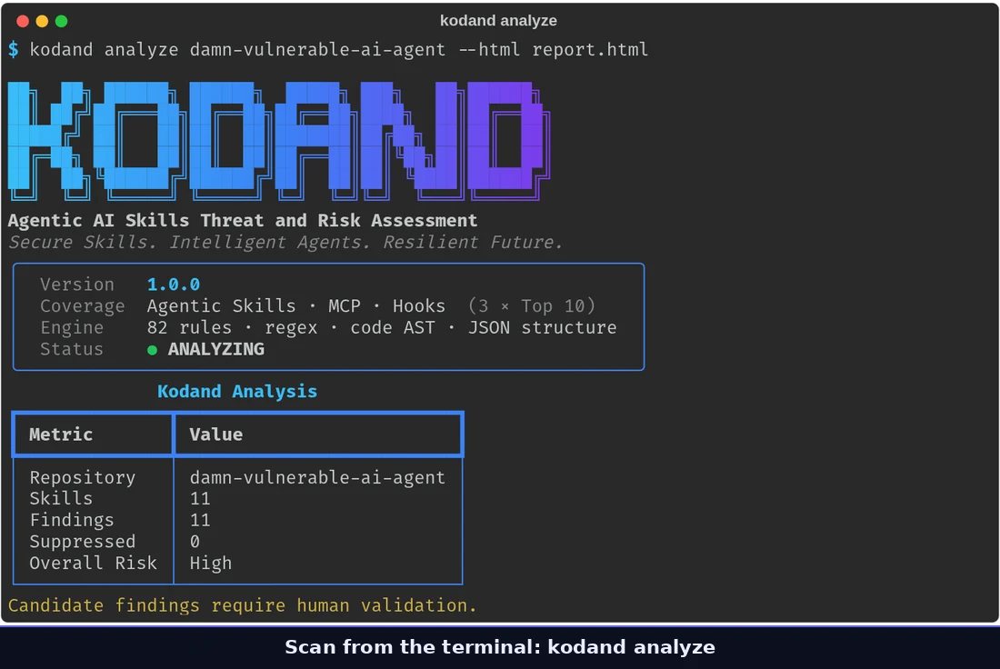
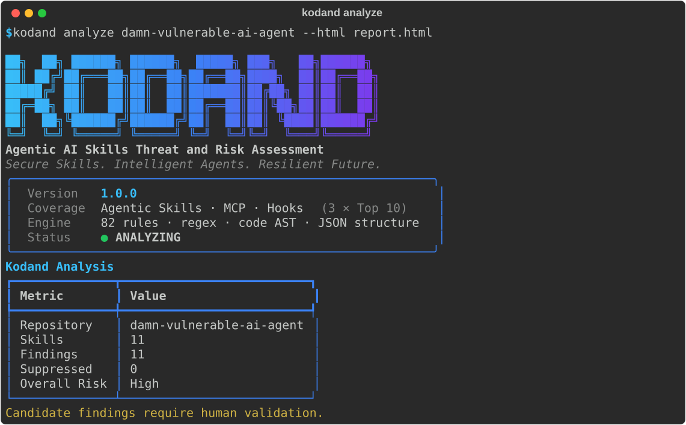

<p align="center">
  
</p>

# Kodand — Agentic AI Skills Threat and Risk Assessment

<p align="center">
  <a href="https://github.com/varotariadarshit/Kodand/blob/master/LICENSE"></a>
</p>

Kodand is a static security scanner for AI agent skills, **MCP server configs**
and **Claude Code hooks**. It finds credential theft, prompt injection hidden in
skills and tool descriptions, typosquatted MCP packages, unsafe code execution,
scanner evasion and more, before any of it runs inside an agent.

```bash
git clone https://github.com/varotariadarshit/Kodand.git && cd Kodand && ./install.sh
kodand analyze ./my-skills --html report.html  # scan a folder or .zip/.tar.gz
kodand ui                                      # or review findings in the web console
```

<p align="center">
  
  <br>
  <sub>A tour of Kodand 1.0.0: the CLI, then the web console — scanning, reports with
  verdict filters, Claude Agent verdicts, suppressions, Live Scans, Settings and more.
  Screens from a demo workspace scanning public test material.</sub>
</p>

**Accuracy:** on OpenA2A's deliberately vulnerable
[damn-vulnerable-ai-agent](https://github.com/opena2a-org/damn-vulnerable-ai-agent),
Kodand reports 11 findings, and a hand review of each one found 11 true positives and
0 false positives. Its labelled benchmark scores 1.00 precision and recall
([method and details](https://github.com/varotariadarshit/Kodand/blob/master/docs/BENCHMARK.md)).

It reads Claude's `SKILL.md`, Gemini CLI's `GEMINI.md`, Copilot instructions,
OpenAI/Codex `AGENTS.md`, Cursor and Windsurf rules, MCP configs, hook configs
and the Python/JS/TS scripts they reference. Detection spans **three
independent taxonomies**, and a rule belongs to exactly one:

- **AST Top 10**: Kodand's own Agentic Skills Top 10 (skill/instruction-file risks)
- **MCP Top 10**: the published [OWASP MCP Top 10 (2025)](https://owasp.org/www-project-mcp-top-10/)
- **Hooks Top 10**: Kodand's own taxonomy for Claude Code hook-config risks

It ships three ways: a **CLI** for scripting and CI, a local **web console** for
reviewing findings, and an **MCP server** so an AI coding agent (Claude Code,
Cursor, etc.) can scan and verify findings from a terminal session. The
[user guide](https://github.com/varotariadarshit/Kodand/blob/master/USER_GUIDE.md) walks through all three.

All automated findings are candidates requiring human validation; Kodand flags
patterns, it doesn't prove exploitability.

## Highlights
- **64 built-in YAML detection templates** across all three taxonomies
  (48 AST + 8 MCP + 8 Hooks — see below), with literal + regex + decoded
  (base64/hex/URL) matching and a composite 0–100 confidence score per finding,
  plus 18 structural rules (see the next two bullets) — 82 detection rules total.
- **Hidden-text and typosquat detection** — zero-width, bidi-control and
  Unicode tag characters (raw or written as HTML entities), and MCP server
  packages one or two characters away from an official package name.
- **AST-level code analysis** — real parsing (not regex) of Python (stdlib
  `ast`) and JS/TS (tree-sitter, optional `code` extra) scripts referenced by
  a skill: dynamic eval/exec, shell-injection shapes, hardcoded credentials,
  and a same-function env-read → network-send exfiltration heuristic.
- **MCP server config & hook detection**, YAML *and* structural — `.mcp.json` /
  `claude_desktop_config.json` / `.claude/settings.json` are first-class scan
  targets: unpinned/shell launchers, wildcard permission grants, hardcoded
  secrets, tool-description injection, insecure transport, disabled audit
  logging, and more, mapped directly to OWASP MCP Top 10 categories. Five of
  these (HOOK01, HOOK05, two MCP04 rules, MCP09) run on a real position-tracking JSON
  parser rather than line regex, so they can correlate two keys of the same
  object — e.g. a wildcard hook `matcher` escalates severity only when its
  *own* `command` looks risky, and "Shadow MCP Servers" (MCP09) actually
  compares every configured server's launcher and name against every other
  one, instead of just checking a single string.
- **Context-aware scoring** — Context Engine v2 understands frontmatter, fenced
  code, and mitigation/detection/reference/example prose so non-actionable
  lines don't inflate results; proximity and cross-file relationship signals
  escalate genuinely suspicious co-occurrences instead.
- **Parallel scanning** — match files across multiple worker processes
  (`--workers N`, or the Parallel workers choice in the web console); sequential
  by default, identical output at any worker count. It helps on large
  repositories; on small ones starting the workers costs more than it saves.
- **Finding review workflow** — mark findings Pending Review / True Positive /
  False Positive / Remediated / Suppressed, with threaded comments. AI verdicts
  show as coloured badges with a one-click **Mark as …** to set the status (never
  automatic), and reports filter findings by verdict as well as severity.
- **Open File, highlighted** — every finding and occurrence in a report links
  straight to the exact file and line in the built-in Files viewer, with the
  matched line highlighted and scrolled into view.
- **AI-assisted review** — one-click AI Review (ChatGPT, Claude, Gemini, or any
  custom OpenAI-compatible endpoint) using the full affected file rather than
  just the matched excerpt, able to open the skill's other files when it needs
  more context, and follow-up chat on any finding. **Ask AI-CLI** answers the same
  kind of question through your own Claude Code login instead of an API key (with
  the affected files in the prompt, but no tools to open others); each AI button
  greys out when it isn't set up.
- **MCP server** (`kodand mcp`) — scan, list findings, read scanned files, and
  verify findings directly from an MCP-capable agent's terminal session,
  without routing through a separately configured AI provider.
- **Claude Agent** (`kodand agent`) — send findings from the web console to
  your own Claude Code for verification, one click per finding, per scan, or
  automatically after a scan, using your own Claude login (no API key). Each
  finding gets a fresh headless run that can only read the finding and its files
  through Kodand's tools and record a verdict, with every built-in tool off. Runs
  one at a time or `--parallel N`, in a terminal or as a background service
  (`--install-service`, Linux/systemd); the sidebar shows whether it's connected,
  Live Scans lists its queue, and Settings shows its token usage. See the
  [User Guide](USER_GUIDE.md#claude-agent--verifying-from-the-web-console).
- **Your own Claude account, locally** — Claude Agent and Ask AI-CLI use the
  Claude Code CLI on your machine with your own Claude login; see
  [Using your own Claude account](#using-your-own-claude-account).
- **Live Scans dashboard** — real-time per-file scan progress and
  AI-verification status, kept as durable history you can review (or delete)
  later instead of disappearing once a scan finishes, plus the Claude Agent queue
  (remove one, selected, or all).
- **Suppression framework** (`.kodand.yml`) with rule/category/path/finding
  selectors and optional expiry. From the web console, setting a finding to
  Suppressed, or **Suppress…** on a False-positive verdict, saves a per-project
  suppression (kept in Kodand's workspace, never written into your source) that
  later scans of the project apply.
- **Job files storage** — the scanned source each scan keeps for review, listed
  per scan with its size, a Keep tag, manual delete, an optional retention period
  and a storage graph (Settings → Job files). Deleting job files never removes
  findings, reports or comments.
- **Ground-truth benchmark** (`kodand bench`) reporting precision/recall/F1 per
  category against a labeled corpus, plus a hand-reviewed real-world scan —
  see [Accuracy](#accuracy).

Version **1.0.0**, rule pack `KODAND-1.0`.

## Detection coverage

Every category below is always listed in the web console's About tab and a
report's coverage matrices, even ones with 0 rules today — this is the full
reference, not just "whatever happened to fire." Rule counts include both YAML
templates and structural (AST/JSON) rules.

### AST Top 10 — Agentic Skills (skill/instruction-file risks)

| Code | Category | Rules |
|---|---|---|
| AST01 | Malicious Skills | 10 |
| AST02 | Supply Chain Compromise | 5 |
| AST03 | Over-Privileged Skills | 9 |
| AST04 | Insecure Metadata and Parsing | 11 |
| AST05 | Untrusted External Instructions | 4 |
| AST06 | Weak Isolation | 5 |
| AST07 | Update and Version Drift | 4 |
| AST08 | Insufficient Scanning | 6 |
| AST09 | Governance and Approval Gaps | 4 |
| AST10 | Cross-Platform Reuse | 3 |

### MCP Top 10 — [OWASP MCP Top 10 (2025)](https://owasp.org/www-project-mcp-top-10/)

| Code | Category | Rules |
|---|---|---|
| MCP01 | Token Mismanagement and Secret Exposure | 1 |
| MCP02 | Privilege Escalation via Scope Creep | 1 |
| MCP03 | Tool Poisoning | 1 |
| MCP04 | Software Supply Chain Attacks and Dependency Tampering | 2 |
| MCP05 | Command Injection and Execution | 1 |
| MCP06 | Intent Flow Subversion | 1 |
| MCP07 | Insufficient Authentication and Authorization | 1 |
| MCP08 | Lack of Audit and Telemetry | 1 |
| MCP09 | Shadow MCP Servers | 1 |
| MCP10 | Context Injection and Over-Sharing | 1 |

MCP04 and MCP09 run on the structural JSON analyzer (`kodand/codeanalysis/json_struct.py`)
rather than a YAML template — MCP04 checks the actual `args` array for an
explicit version pin instead of flagging every `npx`/`uvx`/etc. launch, and
compares each launched package name against official MCP packages to catch
typosquats, and
MCP09 compares every configured server's launcher and name against every
other configured server for real duplicate/shadow detection.

### Hooks Top 10 — Claude Code hook-config risks (Kodand original)

| Code | Category | Rules |
|---|---|---|
| HOOK01 | Unscoped Wildcard Trigger | 1 |
| HOOK02 | Arbitrary Shell Execution in Hook Command | 1 |
| HOOK03 | Silent Network Exfiltration via Hook | 1 |
| HOOK04 | Approval and Permission Bypass via Hook | 1 |
| HOOK05 | Undeclared or Hidden Hook Definition | 1 |
| HOOK06 | Hook Persistence and Config Tampering | 1 |
| HOOK07 | Privilege Escalation via Hook Context | 1 |
| HOOK08 | Sensitive File or Credential Access via Hook | 1 |
| HOOK09 | Resource Abuse and Denial of Service via Hook | 1 |
| HOOK10 | Unverified or Remote Hook Script Source | 1 |

HOOK01 and HOOK05 also run on the structural JSON analyzer — HOOK01 escalates
severity when a wildcard/empty `matcher` is paired with a risky `command` in
the *same* hook entry, and HOOK05 only ever looks at the direct children of
the `hooks` object, so it can't be confused with the required nested
`"hooks": [...]` array key the way a line-based regex could.

## Supported agentic platforms

Content is content, whichever file format carries it:

| Platform | File(s) |
|---|---|
| Claude Code | `SKILL.md`, `SKILLS.md` |
| Google Gemini CLI | `GEMINI.md` |
| Microsoft Copilot | `.github/copilot-instructions.md`, `.github/instructions/*.instructions.md` |
| OpenAI / Codex | `AGENTS.md` |
| Cursor | `.cursor/rules/*.mdc` |
| Windsurf | `.windsurfrules` |
| MCP servers | `.mcp.json`, `mcp.json`, `claude_desktop_config.json` |
| Claude Code hooks | `.claude/settings.json`, `.claude/settings.local.json` |

Referenced Python/JS/TS scripts get real AST-level parsing on top of the
regular text/regex pass (see Highlights above). Subagent/slash-command
definitions and OpenAPI Action schemas are not yet in scope.

## Install

Requires Python 3.11.4+ on Linux or macOS. Windows isn't supported natively;
use [WSL](https://learn.microsoft.com/windows/wsl/).

Kodand isn't published on PyPI; install it from this repository:

```bash
git clone https://github.com/varotariadarshit/Kodand.git
cd Kodand && ./install.sh
kodand
```

Upgrade with `git pull && ./install.sh`. Without a clone, pipx can install straight
from GitHub (`uv tool install` takes the same spec):

```bash
pipx install "kodand[all] @ git+https://github.com/varotariadarshit/Kodand.git"
```

| Extra | Adds |
| --- | --- |
| `ui` | The local web console (`kodand ui`) |
| `mcp` | The MCP server (`kodand mcp`) |
| `code` | JavaScript/TypeScript code analysis (tree-sitter). Python analysis needs no extra |
| `all` | All three |

From a clone, `./install.sh` does the same and always installs everything
(`all`). It first lists the dependencies it needs (Python 3.11.4+, pipx/uv/venv,
tar, git) and, after a y/N prompt, installs any that are missing with your package
manager (`--check` only reports, `--yes` skips the prompt). Afterwards it checks that
the web console, MCP server and code analysis import and prints the next steps. It uses [`pipx`](https://pipx.pypa.io) if
available, then `uv tool install`, then a plain venv under
`~/.local/share/kodand`. It restarts the `kodand-ui` and `kodand-agent` services if
you run them that way, and stops running `kodand mcp` processes so they don't keep
serving the old build — reconnect MCP clients afterwards (`/mcp` in Claude Code, or a
new session).

## CLI



```bash
kodand templates list                 # 64 YAML templates, with Literals + Regex columns
                                      # (plus 18 structural AST/JSON rules not listed here)
kodand templates scan /path/to/repo   # shows match kind (literal/regex/decoded)
kodand analyze /path/to/repo \
  --output output/analysis.json --html output/report.html \
  --sarif output/results.sarif --docx output/report.docx --pdf output/report.pdf \
  --workers 4                        # parallel file matching, sequential by default
kodand bench                           # precision / recall / F1 on packaged corpus
kodand bench /path/to/corpus           # or your own labeled corpus
```

## Accuracy

| Benchmark | Result |
| --- | --- |
| Built-in labelled corpus (`kodand bench`): 54 samples, 50 labelled detections | Precision 1.00 · Recall 1.00 |
| [damn-vulnerable-ai-agent](https://github.com/opena2a-org/damn-vulnerable-ai-agent) 0.9.3, every finding reviewed by hand | 11 findings, 11 true positives, 0 false positives |

The built-in corpus is Kodand's own, so the real-world scan is the check that
matters. Method, the full before/after comparison and how to reproduce both
are in [docs/BENCHMARK.md](https://github.com/varotariadarshit/Kodand/blob/master/docs/BENCHMARK.md).

## Web Console
```bash
kodand ui                     # http://127.0.0.1:8787
```
The tour at the top of this page walks through every screen below.
**First sign-in:** the console is password-protected. A fresh workspace starts with
the default password **`kodand`**, and you're required to replace it before you can
reach the console — the login page shows this hint until you do. Credentials live in
`~/.kodand/auth.json` (PBKDF2-hashed, never stored in plaintext). Changing the
password signs out every existing session.

**Forgot it?** Run `kodand password reset` in a terminal on the machine running Kodand
to set a new one, or `kodand password reset --to-default` to go back to `kodand` and
the forced-change prompt.

Tabs: **Projects** (create/scan/delete, upload a folder or archive, or scan a
server-side path; per-project suppressions), **Live Scans** (real-time pipeline
and AI-verification progress for any running or recent scan, and the Claude Agent
queue), **Custom Templates** (literal **and** regex, global), **Benchmark** (run
precision/recall/F1 in-app), **Settings** (the AI provider for AI Review, MCP
server setup, Claude Agent status and usage, and Job files retention and storage),
**About** (full AST/MCP/Hooks category reference). The sidebar shows whether a
Claude Code MCP session (**Claude MCP**) and the Claude Agent worker (**Kodand
Agent**) are connected.

Reports are split into separate sections per taxonomy — Agentic Skills
findings, MCP server findings, and Hook findings never mix in the same list —
each with its own coverage matrix and category chart. Every finding and
occurrence has an **Open File** button that jumps straight to the exact
file/line in the Files viewer, highlighted.

Each finding can be marked **Pending Review / True Positive / False Positive
/ Remediated / Suppressed**, annotated with comments, sent for a one-click
**AI Review**, and followed up with AI chat or **Ask AI-CLI**. Full walkthrough of every tab and
the review workflow is in the [user guide](https://github.com/varotariadarshit/Kodand/blob/master/USER_GUIDE.md).

Workspace defaults to `~/.kodand/` (override with `KODAND_HOME`).

## MCP Server
```bash
claude mcp add kodand -- kodand mcp
```
Lets an MCP-capable agent (Claude Code, Cursor, etc.) scan and verify
findings directly from a terminal session — no separate AI-provider quota
required for verification. Setup, the full tool reference, and the
`verify_finding` vs. `add_finding_comment` distinction are in the [user guide](https://github.com/varotariadarshit/Kodand/blob/master/USER_GUIDE.md).

## Suppression example (`.kodand.yml` at repo root)
```yaml
suppressions:
  - rule: AST08-SCANNER-BYPASS
    reason: documented anti-pattern, reviewed
    expires: 2027-01-01
  - category: AST05
    path: "docs/**"
    reason: external links expected in docs
```

## Custom template with regex
```yaml
id: CUSTOM-AWS-KEY
info: {name: AWS Access Key, severity: high, confidence: high, category: CUSTOM}
detection:
  match: ["aws_access_key_id"]
  regex: ["AKIA[0-9A-Z]{16}"]
capabilities: [credential-access, secret-output]
risk: {title: AWS Access Key}
recommendation: Never embed long-lived AWS keys; use scoped roles.
```

## Using your own Claude account

Kodand is free, open-source software under the [MIT License](LICENSE) that you
install and run yourself, on your own machine; the web console listens only on
localhost unless you start it with `--allow-remote`. It isn't a hosted or licensed service, and it doesn't provide, resell or
proxy access to Claude. **Claude Agent** and **Ask AI-CLI** run the Claude Code CLI
(`claude`) already installed on your machine, signed in with **your own Claude
account**, so that usage is yours, under your own Claude plan and Anthropic's terms,
the same as running `claude` yourself. Kodand never sees your Claude credentials.

## Contributing and security

Bug reports, false positives, missed detections and pull requests are welcome;
see [CONTRIBUTING.md](https://github.com/varotariadarshit/Kodand/blob/master/CONTRIBUTING.md). Please report vulnerabilities in
Kodand itself privately, as described in [SECURITY.md](https://github.com/varotariadarshit/Kodand/blob/master/SECURITY.md).

## License

[MIT](https://github.com/varotariadarshit/Kodand/blob/master/LICENSE)
